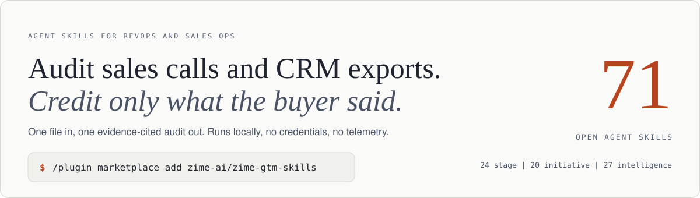
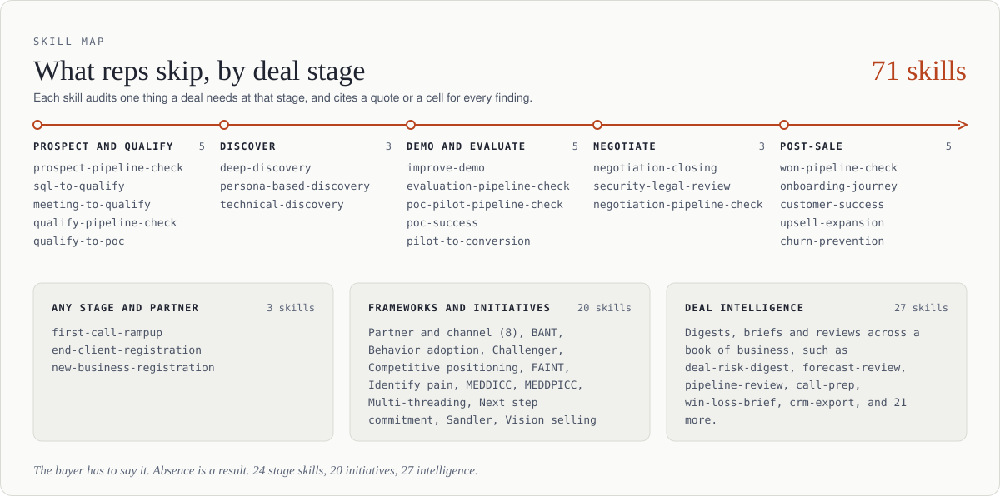
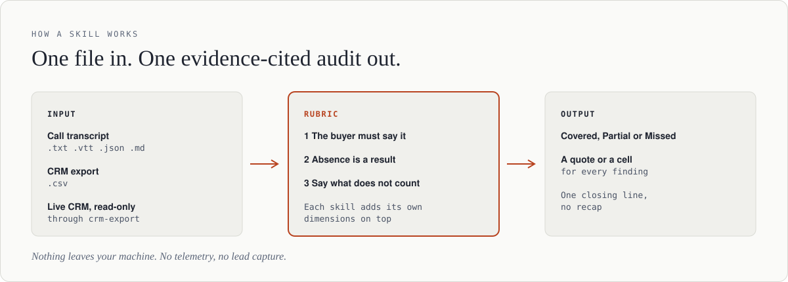
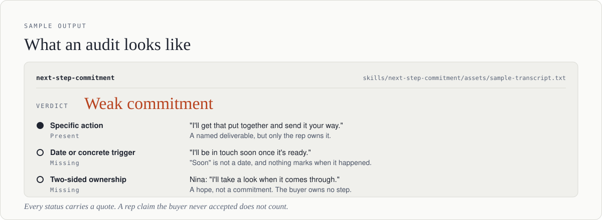

<p align="center">
  <picture>
    <source media="(prefers-color-scheme: dark)" srcset="docs/img/hero-dark.svg">
    
  </picture>
</p>

<p align="center">
  <a href="skills/"></a>
  <a href="https://github.com/zime-ai/zime-gtm-skills/actions/workflows/validate.yml"></a>
  <a href="LICENSE"></a>
  <a href="https://agentskills.io"></a>
  <a href="https://zime.ai"></a>
</p>

<p align="center"><b><a href="#quick-install">Install</a> · <a href="#ask-your-agent-in-plain-words">Try it</a> · <a href="#see-it-work">See it work</a> · <a href="#how-these-fit-together">Skill map</a> · <a href="#available-skills">All skills</a> · <a href="#connect-your-crm-optional">Connect your CRM</a> · <a href="#faq">FAQ</a></b></p>

If you're building call-review or deal-inspection tooling in-house, start here. 71 [Agent Skills](https://agentskills.io) audit sales call transcripts and CRM exports against GTM rubrics. You give a skill one file and get one audit back, with a quote or a cell behind every finding. It runs locally with no credentials, and nothing leaves your machine. It works with Claude Code, Cursor, Windsurf, OpenAI Codex, and any agent that reads the Agent Skills spec.

These skills credit a call only for what the buyer said, and each one targets what reps usually skip at that deal stage. A rep's claim never counts as evidence. A topic the call never touched scores Missed. Every dimension lists what does not count (price worry is not a budget, a date for the next meeting is not a decision date, a job title is not authority) and gives the rep one question to ask next time.

Skills sort on two axes: **deal stage** (discovery through renewal) and **initiative** (MEDDICC, BANT, pain identification, and other frameworks that run at any stage).

Every skill follows one rule: a finding without a quote or a timestamp does not ship. Each dimension marked Covered, Partial, or Missed points at the line that earned it.

MIT, no gating, no telemetry, no lead capture. Fork it, rewrite the rubrics for your motion, and ship it internally. Zime builds and maintains this repo, and we would rather hand over the rubrics than talk anyone out of building.

Contributions are welcome, see [CONTRIBUTING.md](CONTRIBUTING.md). To report a bug or ask a question, [open an issue](https://github.com/zime-ai/zime-gtm-skills/issues).

## Ask your agent in plain words

The agent picks the skill from your request. You can also call one by name, such as `/deep-discovery calls/acme.txt`.

- *"Review this discovery call and tell me what the rep skipped."* (`deep-discovery`)
- *"Did this call end with a real next step?"* (`next-step-commitment`)
- *"Which deals in this pipeline export are at risk before Friday's forecast call?"* (`deal-risk-digest`)
- *"Prep me for tomorrow's call with this account."* (`call-prep`)
- *"Read my open deals from HubSpot, read-only, and check the Qualify stage."* (`crm-export`, then `qualify-pipeline-check`)

## Quick install

```bash
# Claude Code plugin (recommended)
/plugin marketplace add zime-ai/zime-gtm-skills
/plugin install gtm-skills@zime-gtm-skills
```

```bash
# or install with the skills CLI (Claude Code, Cursor, Codex, and others)
npx skills add zime-ai/zime-gtm-skills
```

```bash
# or clone and copy into any agent that reads the Agent Skills format
git clone https://github.com/zime-ai/zime-gtm-skills.git
cp -r zime-gtm-skills/skills/* .agents/skills/
```

Use the Claude desktop app instead? See
[Option 5](#option-5-claude-desktop-and-claudeai) below. For the submodule
option and the `.claude/skills/` vs `.agents/skills/` distinction, see
[Installation](#installation).

## See it work

Live demo, one call reviewed with and without a skill: <https://zime-ai.github.io/zime-gtm-skills/>

Real output from three skills, one per output shape, each run against its
own bundled sample data. Nothing is invented for this README. Skim the
tables; the full run (quotes and all) is one click away in each
`<details>`.

### Transcript audit: `deep-discovery`

Same synthetic call, two ways: a plain "review this call" prompt with no
skill, and `deep-discovery` against
`skills/deep-discovery/assets/sample-transcript.txt`.

**Without the skill**, unaided, prompted "review this discovery call": a
free-form paragraph. No repeatable structure, no consistent evidence
format, findings and commentary interleaved; a different rep reading the
same call would flag different things.

**With `deep-discovery`**, same 9 dimensions every run, each Covered/
Partial/Missed tied to a quote:

| Dimension | Result |
|---|---|
| 1. Pain & business impact | Covered |
| 2. Current state & tooling | Covered |
| 3. Trigger (why now) | Covered |
| 4. Desired outcome | Covered |
| 5. Decision process | Covered |
| 6. Budget & timeline | Partial |
| 7. Procurement & buying path | Covered |
| 8. Competitive landscape | Covered |
| 9. Rapport | Covered |

8/9 Covered, 1 Partial, zero Missed, and zero fault-finding bias: a call
that genuinely covered discovery well comes back reading well.

<details>
<summary>Full output, with quotes behind every result</summary>

```
1. Pain & business impact — Covered
   "spends probably 8-10 hours a week just chasing down exception
   statuses"

2. Current state & tooling — Covered
   "Dispatchers log exceptions in a shared spreadsheet"

3. Trigger — why now — Covered
   "we lost a mid-size account last quarter over a missed exception,
   and our board asked for a logistics-ops review this quarter"

[... 4. Desired outcome, 5. Decision process — both Covered, trimmed ...]

6. Budget & timeline — Partial
   CFO approval threshold ($40k) surfaced, but that's an approval
   gate, not deal-specific budget. No explicit decision-date beyond
   "before Q3 planning."

7. Procurement & buying path — Covered
   "anything touching our TMS goes through a security review with
   our IT director. Usually takes about three weeks"

[... 8. Competitive landscape, 9. Rapport — both Covered, trimmed ...]

Reads-well-too check: 8/9 Covered, 1 Partial, zero Missed — matches a
call that clearly covered discovery well. No fault-finding bias here.

Highest-leverage next steps:
1. Nail a real budget number, not just the approval gate.
2. Pin a hard decision date, not "before Q3 planning."
```
</details>

Invoke it by name, like any Claude Code skill:

```
/deep-discovery skills/deep-discovery/assets/sample-transcript.txt
```

### CSV pipeline-sweep: `deal-risk-digest`

**Without the skill**: eyeball 8 CRM export rows by hand, no ranking, no
consistent signal, no tiebreak logic.

**With `deal-risk-digest`** against
`skills/deal-risk-digest/assets/sample-pipeline-deal-risk.csv`: ranked,
most at-risk first, every flag cited to the cell behind it.

| Deal | Risk | Signal |
|---|---|---|
| Fairview Logistics | High (6) | past-due + unlikely, stage age, vague next step, single-threaded |
| Cobalt Freight Partners | High (3) | past-due + unlikely |
| Ashgrove Dental Partners | Medium (2) | blank next step, single-threaded |
| Driftwood Realty Group | Medium (1) | stage age |
| Terra Foods Co-op | Medium (1) | blank next step |
| Solstice Robotics | Medium (1) | single-threaded |
| Meridian Health Systems | Low (0) | none |
| Bluewater Analytics | Low (0) | none |

Closing read: 2 of 8 deals rated High risk. The most common signal across
flagged deals is past-due-and-unlikely (a close date already behind
today, paired with under-50% probability).

<details>
<summary>Full output, with the CSV cell behind every flag</summary>

```
All columns present, no signals skipped.

| Deal | Risk | Reasons | Evidence |
|---|---|---|---|
| Fairview Logistics | High (6pts) | past-due+unlikely, stage age, vague next step, single-threaded | close_date = 2025-03-01 (past), probability = 25%; days_in_stage = 280; next_step = "Follow up"; contacts = "Greg Malone" |
| Cobalt Freight Partners | High (3pts) | past-due+unlikely | close_date = 2025-02-14 (past), probability = 20% |
| Ashgrove Dental Partners | Medium (2pts) | blank next step, single-threaded | next_step = (empty); contacts = "Dr. Lila Fenn" |
| Driftwood Realty Group | Medium (1pt) | stage age | days_in_stage = 210 |
| Terra Foods Co-op | Medium (1pt) | blank next step | next_step = (empty) |
| Solstice Robotics | Medium (1pt) | single-threaded | contacts = "Priya Shah" |
| Meridian Health Systems | Low (0pts) | none | — |
| Bluewater Analytics | Low (0pts) | none | — |

- 2 of 8 deals rated High risk
- Most common risk signal across them: past-due and unlikely (close date past + probability below 50%)
```
</details>

```
/deal-risk-digest skills/deal-risk-digest/assets/sample-pipeline-deal-risk.csv
```

### Document-writer: `champion-tracker`

**Without the skill**: a rep's own notes say "good engagement from
both stakeholders," with no way to tell who is selling internally and who
only likes the product.

**With `champion-tracker`** against
`skills/champion-tracker/assets/sample-call-1.txt` and `sample-call-2.txt`:
one cited action ledger, one verdict per contact.

| Contact | Call | Tag | Why |
|---|---|---|---|
| Priya | 1 | Sentiment | "I'll flag this to procurement next week," a plan, not done yet |
| Devon | 1 | Sentiment | "Really excited about this," enthusiasm |
| Priya | 2 | Action | Looped in procurement, confirmed |
| Priya | 2 | Action | Pushed back on price for the deal in a leadership sync the rep wasn't in |
| Devon | 2 | Sentiment | "I'll definitely be a happy user," enthusiasm, still no action |

**Champion read**: Priya is a champion, with 3 confirmed Action rows by
call 2. Devon is not, because every row across both calls is Sentiment.
He is a friend, not a champion.
**Trend**: strengthening, an unconfirmed plan in call 1 became 3
delivered actions in call 2.

<details>
<summary>Full ledger, all 12 rows across both calls</summary>

```
| Contact | Call | Quote | Tag | Why |
|---|---|---|---|---|
| Priya | 1 | "I'll flag this to our procurement team next week so they can start looking at the contract terms" | Sentiment | future promise, not yet done |
| Devon | 1 | "Honestly this would save us so much time." | Sentiment | praised time savings |
| Priya | 1 | "The integration piece looks straightforward, which is a relief." | Sentiment | positive remark |
| Devon | 1 | "Yeah I'm honestly really excited about this. Our team has been asking for something like this for months." | Sentiment | enthusiasm |
| Priya | 1 | "I think it's a good fit. Let me get procurement looped in and we'll see what they come back with." | Sentiment | still a plan, not confirmed |
| Devon | 1 | "No, this all looks great. Can't wait to get this rolled out." | Sentiment | enthusiasm |
| Priya | 2 | "Good news — I looped in procurement last week, they're already reviewing the contract." | Action | looped in procurement (confirmed) |
| Priya | 2 | "When Marcus in finance pushed back on the price in our Monday leadership sync, I pushed back and walked the room through why this is worth it." | Action | pushed back internally, room rep wasn't in |
| Devon | 2 | "Yeah this is going to make everyone's life easier once it's live. I'm honestly thrilled about it." | Sentiment | enthusiasm |
| Devon | 2 | "I mean, I'll definitely be a happy user. This is exactly the kind of thing we've needed." | Sentiment | enthusiasm, no action |
| Priya | 2 | "I also set up a short call with our security team for Thursday so we can clear that before the contract review finishes." | Action | legwork, scheduled internal blocker-clearing |
| Devon | 2 | "Agreed, sounds like it's all coming together nicely." | Sentiment | enthusiasm |
```
</details>

```
/champion-tracker skills/champion-tracker/assets/sample-call-1.txt skills/champion-tracker/assets/sample-call-2.txt
```

### Try any other skill

Same pattern, every skill: clone once, then invoke any skill by name
against its own bundled sample.

```bash
git clone https://github.com/zime-ai/zime-gtm-skills.git
cd zime-gtm-skills
```

Then, inside Claude Code or Claude Desktop:

```
/<skill-name> skills/<skill-name>/assets/<sample-file>
```

Every skill ships its own sample data and documents the exact filename(s)
and command in its `SKILL.md`'s "Sample data" section. Click through from
the skill's row in [Available skills](#available-skills) below.

## How these fit together

71 skills: 24 stage motions laid out across the deal lifecycle, 20
cross-stage initiative skills, and 27 deal-intelligence skills that write
something forward (a plan, a digest, a drafted email) instead of grading
a call.

<p align="center">
  <picture>
    <source media="(prefers-color-scheme: dark)" srcset="docs/img/skill-map-dark.svg">
    
  </picture>
</p>

### How a skill works

<p align="center">
  <picture>
    <source media="(prefers-color-scheme: dark)" srcset="docs/img/how-it-works-dark.svg">
    
  </picture>
</p>

### What an audit looks like

<p align="center">
  <picture>
    <source media="(prefers-color-scheme: dark)" srcset="docs/img/sample-output-dark.svg">
    
  </picture>
</p>

Unlike some agent-skill collections, there's no foundational context skill
every other one depends on, and no required order. Each skill is independent:
one call transcript (or CRM export) in, one evidence-cited audit out.

## Company context (optional)

Every skill runs with zero setup. It reads the file you point it at and
nothing else. But without any company context, a skill has no way to
know your ICP, your product's actual differentiators, or which competitor
names to expect, so it audits each call in a vacuum.

If a file named `.agents/gtm-context.md` or `.claude/gtm-context.md` exists
in your working directory, every skill in this repo reads it first and
does not ask for anything it already answers. There is no flag and no
config: drop the file in and the skills pick it up. See
[`gtm-context.example.md`](gtm-context.example.md) for the shape: ICP,
product/pricing basics, named competitors, and internal terminology or
stage names that differ from the generic ones a skill assumes by default.

This file is yours, never the repo's. Nothing reads it except the skill at
run time, and nothing in it leaves your machine beyond what your agent's own
model call already sends.

## Connect your CRM (optional)

No skill needs a CRM. Every pipeline skill reads a CSV export. If your CRM already has an AI connector (HubSpot, Salesforce, Pipedrive, Close, Attio, Zoho, Dynamics), the `crm-export` skill can read open deals through it, read-only, and write a small local CSV for the other skills. It never writes to your CRM and never asks for a password or key. Review the connector with your security team first. See [`docs/crm-connectors.md`](docs/crm-connectors.md) for the read-only setup and the security notes.

## Available skills

Every skill here follows the evidence rules above. `deep-discovery`, `meddicc`, `bant`, `technical-discovery` and `meeting-to-qualify` also have planted-fact test banks that you can run as a manual regression check (see `SKILL-DESIGN.md`). `deep-discovery` is the best rubric to read first.

<details open>
<summary>71 skills across new business, post-sale, cross-stage initiative, and deal intelligence</summary>

<!-- SKILLS:START -->
**New business**

| Skill | Audits | Input |
|---|---|---|
| [new-business-registration](skills/new-business-registration/) | A new-logo deal-registration record for completeness: entity identification, duplicate/conflict check, source attribution, ICP fit, expiry window | CRM export (`.csv`) or transcript |
| [end-client-registration](skills/end-client-registration/) | A partner/reseller's end-client deal registration: partner identity, end-client entity kept distinct, engagement scope, conflict check against direct pipeline, permission to engage, commercial terms, expiry | CRM export (`.csv`) or transcript |
| [sql-to-qualify](skills/sql-to-qualify/) | Whether a freshly-assigned SQL is a real opportunity: right contact, pain in their own words, rough budget/urgency fit, competitive awareness, concrete next meeting | transcript or CRM export |
| [deep-discovery](skills/deep-discovery/) | Early-stage discovery call quality: pain, trigger, decision process, budget/timeline, procurement, competition, rapport | transcript (`.txt`/`.vtt`/`.json`/`.md`) or CRM export (`.csv`) |
| [persona-based-discovery](skills/persona-based-discovery/) | Whether a discovery call was tailored to the buyer persona in the room: role ID, pain framing, proof points, objection handling, next step | transcript or CRM export |
| [meeting-to-qualify](skills/meeting-to-qualify/) | Whether a deal is real: authority, budget plausibility, urgency, fit, competitive situation, concrete next step | transcript or CRM export |
| [technical-discovery](skills/technical-discovery/) | Whether a POC is set up to succeed: current stack, future-state fit, scope clarity, technical stakeholders, resourcing | transcript or CRM export |
| [improve-demo](skills/improve-demo/) | Demo quality: tailoring, stakeholder presence, engagement, competitive differentiation, clear next step | transcript or CRM export |
| [qualify-to-poc](skills/qualify-to-poc/) | Whether a POC kickoff is set up to succeed before it starts: success criteria, technical scope, stakeholder commitment, timeline/exit criteria, resourcing | transcript or CRM export |
| [pilot-to-conversion](skills/pilot-to-conversion/) | Pilot/POC health: plan alignment, technical readiness, user engagement, results against criteria, conversion path | transcript or CRM export |
| [poc-success](skills/poc-success/) | A completed POC/pilot's exit review: each success criterion verdict-ed with evidence, end-user validation, sponsor sign-off, production-readiness blockers, commercial next step | transcript or CRM export |
| [negotiation-closing](skills/negotiation-closing/) | Late-stage deal momentum: pricing reaction, procurement progress, contracting awareness, closure timeline | transcript or CRM export |
| [first-call-rampup](skills/first-call-rampup/) | New-rep foundational technique: opening, open-ended questioning, pain uncovering, pitch clarity, rapport | transcript only |
| [prospect-pipeline-check](skills/prospect-pipeline-check/) | A prospect-stage pipeline export for deals with no two-way engagement: no reply, no meeting held, single-threaded and unanswered, aged with no activity | CRM export (`.csv`) or connector |
| [qualify-pipeline-check](skills/qualify-pipeline-check/) | A pipeline export for deals advanced past Qualify with no economic buyer, stated pain, budget signal, next step, or a close date that fits the procurement cycle | CRM export (`.csv`) or connector |
| [evaluation-pipeline-check](skills/evaluation-pipeline-check/) | A pipeline export for technical evaluations running with no success criteria, technical champion, or end date, plus evaluations running long or stalled against the export's own norms | CRM export (`.csv`) or connector |
| [poc-pilot-pipeline-check](skills/poc-pilot-pipeline-check/) | A pipeline export for POCs and pilots with no written exit criteria, conversion date, or executive sponsor, and POCs already past their own end date | CRM export (`.csv`) or connector |
| [negotiation-pipeline-check](skills/negotiation-pipeline-check/) | A pipeline export for negotiation-stage deals with no paper process started, no approver on a discount, no named signer, or a close date that has already slipped | CRM export (`.csv`) or connector |
| [won-pipeline-check](skills/won-pipeline-check/) | A closed-won export for missing handoff data: CS owner, kickoff date, signed value/term, contract reference, and won/close date inconsistencies | CRM export (`.csv`) or connector |
| [security-legal-review](skills/security-legal-review/) | Security and legal review steps: requirements known, reviewers named, document status, step durations, fit with the decision date, open items | transcript |

**Post-sale**

| Skill | Audits | Input |
|---|---|---|
| [onboarding-journey](skills/onboarding-journey/) | New-customer onboarding health: setup experience, sentiment, engagement, milestone clarity | transcript or CRM export |
| [customer-success](skills/customer-success/) | Periodic QBR/health-review depth: value vs. original goals, usage breadth, issue resolution, strategic alignment | transcript or CRM export |
| [churn-prevention](skills/churn-prevention/) | Renewal risk: value realization, usage depth, champion strength, sentiment, service friction | transcript or CRM export |
| [upsell-expansion](skills/upsell-expansion/) | Expansion readiness: account health check first, opportunity clarity, champion strength, strategic alignment | transcript or CRM export |

**Initiative (cross-stage)**

| Skill | Audits | Input |
|---|---|---|
| [meddicc](skills/meddicc/) | MEDDICC coverage: Metrics, Economic buyer, Decision criteria, Decision process, Identify pain, Champion, Competition | transcript or CRM export |
| [meddpicc](skills/meddpicc/) | MEDDPICC coverage: MEDDICC plus Paper Process (legal, procurement, security review, signature path, redlines) | transcript or CRM export |
| [faint](skills/faint/) | FAINT coverage: Funds, Authority, Interest, Need, Timing, for buyers with no articulated need yet | transcript or CRM export |
| [sandler](skills/sandler/) | Sandler Submarine coverage: bonding & rapport, up-front contract, pain, budget, decision, fulfillment, post-sell | transcript or CRM export |
| [challenger](skills/challenger/) | Challenger Sale coverage: teach, tailor, take control, and the commercial-teaching pitch arc | transcript or CRM export |
| [bant](skills/bant/) | BANT coverage: Budget, Authority, Need, Timeline. A lighter pass for early-stage qualification | transcript or CRM export |
| [pain-finder](skills/pain-finder/) | Ranked pain points with confidence and evidence | transcript |
| [next-step-commitment](skills/next-step-commitment/) | Whether a call ended in a real, dated, two-sided commitment vs. a vague "we'll circle back" | transcript or CRM export |
| [adoption-leaderboard](skills/adoption-leaderboard/) | Ranks reps by adoption of five fixed winning behaviors (rapport, upsell signals, renewal risk, customer experience, value realization) across recent calls, lowest first | transcript or connector |
| [sell-the-dream](skills/sell-the-dream/) | Whether a call builds a future-state vision before pitching product, scored against Andy Raskin's "5 Elements of a Great Sales Narrative" and flagged for feature-first sequencing violations | transcript |
| [competitive-positioning](skills/competitive-positioning/) | How a rep positioned against a named rival: buyer's criteria heard, difference tied to a criterion, proof, honest gap, buyer test | transcript |
| [multi-threading](skills/multi-threading/) | Buying-group breadth: group mapped, approver reached, technical evaluator reached, daily users heard, second advocate, dated plan to broaden | transcript |
| [partner-business-review](skills/partner-business-review/) | A partner QBR: results against goals, named pipeline, registration status, blockers with owners, next goal | transcript |
| [channel-partner-engagement](skills/channel-partner-engagement/) | How engaged a channel partner is: figures, capacity, reach, last real activity, enablement, dated plan | transcript |
| [partner-pain-points](skills/partner-pain-points/) | A partner's own problems: the problem, its cost, who feels it, root cause, prior fix, what would help | transcript |
| [partner-sentiment](skills/partner-sentiment/) | How a channel partner really feels: stance in their words, action behind it, rivals they favor, friction, long-term intent | transcript |
| [partner-competition-landscape](skills/partner-competition-landscape/) | What a partner carries: rivals, share, differences, terms, switch conditions, conflict rules | transcript |
| [partner-decision-authority](skills/partner-decision-authority/) | Who decides at a partner and how: decider, process, criteria, commitment, competing priorities, dated decision | transcript |
| [ideal-channel-partner-profile](skills/ideal-channel-partner-profile/) | Fit evidence for a prospective partner: buyer relationship, vendor work, capacity, reach, technology habits | transcript |
| [partner-potential](skills/partner-potential/) | Whether a partner's deal is real: named end customer, fit stated by both sides, purchase step, timeline, roles, terms | transcript |

**Deal intelligence**

| Skill | Audits | Input |
|---|---|---|
| [mutual-action-plan](skills/mutual-action-plan/) | Writes a mutual action plan from a call: milestones from today to signature, each with an owner on both sides and a date, tagged `heard` or `inferred` | transcript or CRM export |
| [deal-risk-digest](skills/deal-risk-digest/) | Ranks a whole pipeline export by risk: past-due close date against low probability, stage age, vague next step, single-threaded contact | CRM export (`.csv`) |
| [deal-highlights](skills/deal-highlights/) | Writes a short highlights digest of one call: a commitment, an objection, a buying signal, a competitive mention, a risk, each cited with its quote | transcript |
| [follow-up-email-drafter](skills/follow-up-email-drafter/) | Drafts the follow-up email a rep sends after a call, grounded in what was heard vs. proposed, with grounding notes flagging which lines to confirm before sending | transcript |
| [win-loss-brief](skills/win-loss-brief/) | Writes a brief on why one closed deal was won or lost: outcome plus 3-5 cited drivers, each tagged clear or tentative | transcript or CRM export |
| [executive-briefing](skills/executive-briefing/) | Writes the short brief a rep sends upward on one deal: snapshot, status, risk, and the ask, each claim cited to a quote or a CSV column/cell | transcript or CRM export |
| [champion-tracker](skills/champion-tracker/) | Builds a cited action ledger of who acts like a champion across a deal's calls and who is only enthusiastic, and reads the trend | transcript |
| [competitor-battlecard](skills/competitor-battlecard/) | Writes a battlecard for the competitor a buyer named on a call: their framing, the rep's counter, and what went unanswered, citing only the transcript | transcript |
| [loss-review](skills/loss-review/) | Whether a loss debrief learned the real reason: outcome confirmed, reason in the buyer's words, chosen option, decider, flip condition, reopen condition | transcript |
| [call-prep](skills/call-prep/) | Prep for the next call from the prior calls: where things left off, open commitments, what is still unknown, risks, a proposed agenda and ask | transcript |
| [handover-to-customer-success](skills/handover-to-customer-success/) | Sales to Customer Success handover: why they bought, success measure, people, what was promised, gaps, key dates | transcript |
| [renewal-prep](skills/renewal-prep/) | Renewal prep from recent customer calls: value in the customer's words, who uses it, risks, open issues, real expansion signals | transcript |
| [coaching-plan](skills/coaching-plan/) | A coaching plan for one rep from two or more calls: the repeated pattern, a question to practice, a drill | transcript |
| [stuck-deal-digest](skills/stuck-deal-digest/) | Deals that stopped moving: silent, aged in stage, overdue next step, with the cells behind each call | CRM export |
| [pipeline-review](skills/pipeline-review/) | Weekly pipeline review brief: snapshot by stage, change since the last export, deals that need attention, data gaps | CRM export |
| [forecast-review](skills/forecast-review/) | Tests the commit list: commit deals that do not hold up, with cited cells and value at risk | CRM export |
| [wbr-report-generator](skills/wbr-report-generator/) | Numbers section of a weekly business review: headline figures, movement, risks, what the export cannot tell | CRM export |
| [objection-pattern-digest](skills/objection-pattern-digest/) | Objections that repeat across calls: themes, call counts, resolved or not, what worked | transcripts |
| [competitive-loss-digest](skills/competitive-loss-digest/) | Which rivals take deals and why: counts, amount lost, buyer-stated versus rep-stated reasons | CRM export |
| [rep-ramp-status-digest](skills/rep-ramp-status-digest/) | A new rep's ramp status by technique across weeks: improving, flat, regressing, not enough evidence | transcripts |
| [crm-export](skills/crm-export/) | Reads open deals from your connected CRM, read-only, and writes a local CSV for the pipeline skills (optional, never writes to the CRM) | connector |
| [client-testimonial-finder](skills/client-testimonial-finder/) | Finds quotable customer lines in a call and sorts out the lines that are not usable or need permission | transcript |
| [reference-case-study-drafter](skills/reference-case-study-drafter/) | Drafts a short customer case study from a customer call, built only from the customer's words, with the figures and permission still needed | transcript |
| [account-plan-generator](skills/account-plan-generator/) | Plans one account from its call transcripts: people and roles, what they want, open items, and the gaps to close in 30 days | transcript |
| [territory-summary](skills/territory-summary/) | Summarizes coverage by territory from an account export: open amount, concentration in one account, and accounts gone quiet | csv |
| [discount-pattern-digest](skills/discount-pattern-digest/) | Finds discount patterns by owner and outlier in a pipeline export, naming an owner only when three deals support it | csv |
| [deal-desk-approval-brief](skills/deal-desk-approval-brief/) | Writes an approval brief from a pipeline export: deals with a discount well above the export's own norm, what each approver still needs, and open approvals | csv |
<!-- SKILLS:END -->

</details>

All 24 stage motions are covered; the initiative set is 20 skills today.
New skills welcome, see [CONTRIBUTING.md](CONTRIBUTING.md). For how these
are tested, and what that testing can and can't prove, see
[EVALS.md](EVALS.md).

## Repository structure

```
zime-gtm-skills/
├── .claude-plugin/
│   ├── marketplace.json       # /plugin marketplace add zime-ai/zime-gtm-skills
│   └── plugin.json
├── skills/
│   └── skill-name/
│       ├── SKILL.md          # required
│       ├── references/       # optional, the rubric lives here
│       ├── assets/           # synthetic sample transcript/CSV
│       └── evals/            # declarative evals.json
├── validate-skills.sh         # local, zero-dep frontmatter/layout check
├── scripts/                    # check-docs-sync.sh, scan-content.py, pr-prep.sh
├── tests/                      # fixture tests for the validators above
├── evals/                       # eval methodology assets, see EVALS.md
├── CONTRIBUTING.md
├── MAINTAINING.md              # process + decisions, for picking this repo back up
├── ROADMAP.md                  # what's built, what's next
├── LICENSE
└── README.md
```

## Where this stops

Each run reads the files you point it at, in one session, with no memory between runs. That sets limits you should know before you build on it.

- A skill audits the call or export you give it. Auditing every call an org makes, as it happens, is a pipeline problem, not a rubric problem.
- Runs are independent. Some skills compare several calls or rows in one run, but nothing tracks a rubric across a rep's quarter or a pipeline over time unless you keep the earlier outputs and feed them back in.
- Skills read and never write back. A CSV goes in, or rows come in through a read-only CRM connector with `crm-export`. Nothing updates a deal record or feeds a forecast.
- The rubrics are hand-written and not calibrated. They come from experience and community correction, not from regression against your own won and lost data. Treat them as a sound default, not a model fitted to your motion.
- There is no rep or manager interface. An engineer runs a command. Assignment, coaching loops, and adoption tracking are out of scope.

Past these limits you are building a platform, which is a much larger piece of work. [Zime](https://zime.ai) works on that problem.

## FAQ

**Do I need an API key or any credentials?** No. Every skill is a markdown
rubric your agent reads and applies to a file you already have. Nothing
here calls out to a service, and nothing you feed a skill leaves your
machine beyond whatever your agent's own model call already sends. If you
choose to connect a CRM, the connector you set up holds the credentials, never
these skills.

**My agent isn't picking up the skill.** Claude Code reads
`.claude/skills/`, not `.agents/skills/`. If you installed via Option 3 or
4 below for Claude Code, copy (or symlink) into `.claude/skills/` instead. The skills CLI in Option 2 does this for you. For
other agents, confirm they read the [Agent Skills spec](https://agentskills.io)
format and that the skill directory is where that agent expects it.

**A skill's output doesn't look right.** If the rubric is the problem (a
missed dimension, a wrong classification), that is the most useful kind of
issue, so see [CONTRIBUTING.md](CONTRIBUTING.md#ways-to-help). If it's install
or tooling breaking, [open a bug report](https://github.com/zime-ai/zime-gtm-skills/issues/new/choose).

## Installation

### Option 1: Claude Code plugin

```bash
/plugin marketplace add zime-ai/zime-gtm-skills
/plugin install gtm-skills@zime-gtm-skills
```

### Option 2: The skills CLI

```bash
npx skills add zime-ai/zime-gtm-skills                      # pick skills and agents
npx skills add zime-ai/zime-gtm-skills -s deep-discovery    # one skill
```

The CLI copies each skill into the folder your agent reads, for example `.claude/skills/`. The CLI counts installs for the skills.sh leaderboard. This repo sends nothing.

### Option 3: Clone and copy

```bash
git clone https://github.com/zime-ai/zime-gtm-skills.git
cp -r zime-gtm-skills/skills/* .agents/skills/
```

Or copy only the skill you want: `cp -r zime-gtm-skills/skills/deep-discovery .agents/skills/`.

> [!TIP]
> Claude Code reads `.claude/skills/`, not `.agents/skills/`. See the
> [FAQ](#faq) if your agent isn't picking the skill up.

### Option 4: Git submodule

```bash
git submodule add https://github.com/zime-ai/zime-gtm-skills.git .agents/zime-gtm-skills
```

Update later with `git submodule update --remote`.

### Option 5: Claude desktop and claude.ai

The Claude desktop app and claude.ai take one skill per ZIP file. Each ZIP holds one skill folder, and the folder name must match the skill name.

1. Turn on code execution. Open Settings, then Capabilities, and turn on "Code execution and file creation". On Team plans it is on by default. On Enterprise plans, an owner turns it on in Organization settings.
2. Make a ZIP for each skill you want. Run this in the folder where you cloned the repo:

```bash
cd zime-gtm-skills/skills
zip -r deep-discovery.zip deep-discovery
```

3. In Claude, open Customize, then Skills. Click the plus button, click Create skill, and click Upload a skill. Choose the ZIP file.
4. Make sure that the skill is switched on in the list.
5. Start a new chat and ask in plain words, for example: "Review this discovery call" and attach a transcript. Claude reads a skill only when a conversation starts.

To make one ZIP for every skill, run `mkdir -p ../dist && for d in */; do zip -qr "../dist/${d%/}.zip" "$d"; done` in the `skills` folder. Uploaded skills are private to you until you share them. The menu names come from Anthropic's help article, [Using Skills in Claude](https://support.claude.com/en/articles/12512180-using-skills-in-claude). If your app shows different names, follow the app.

## Built by Zime

[Zime](https://zime.ai) builds sales-call analytics; this repo is the
rubric layer we'd rather hand over than gatekeep. If it's useful, a star
helps other GTM/RevOps teams find it. Business inquiries: support@zime.ai.

## License

MIT, see [LICENSE](LICENSE).

Maintained by [Zime](https://zime.ai).
